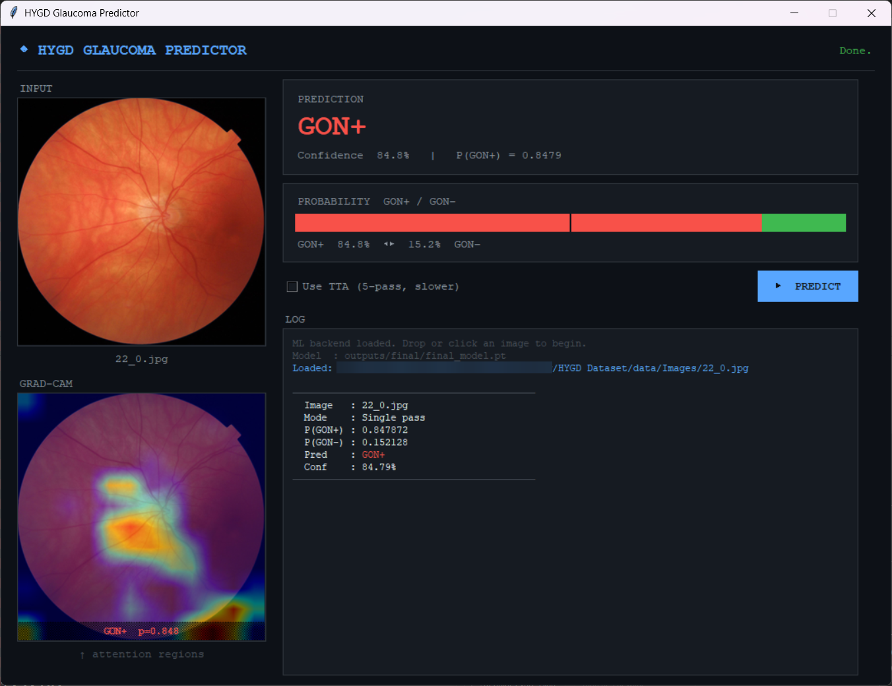

# HYGD Glaucoma Detection

Deep learning pipeline for binary classification of **Glaucomatous Optic Neuropathy (GON)** from fundus photographs, built on the [Hillel Yaffe Glaucoma Dataset v1.0.0](https://physionet.org/content/hillel-yaffe-glaucoma-dataset/1.0.0) (PhysioNet).



---

## Quick Start

**1. Clone and set up environment**
```bash
git clone https://github.com/mrwhitewhite/HYGD_Dataset
cd HYGD_Dataset
python -m venv venv
venv\Scripts\activate.bat       # Windows
# source venv/bin/activate      # Linux / macOS
pip install -r requirements.txt
```

**2. Train**
```bash
python scripts/train.py
```
> A pre-trained checkpoint is **included**. This step can be skipped.

**3. Run the GUI**
```bash
python scripts/gui.py
```
Drag and drop a fundus image for an instant GON+ / GON− prediction with confidence score.

---

## Dataset

| Field | Detail |
|---|---|
| Source | PhysioNet — HYGD v1.0.0 |
| Label file | `Labels.csv` — image filename, patient ID, class, quality score (1–10) |
| Classes | **GON+** (glaucoma present) · **GON−** (healthy) |
| Class ratio | ~73% GON+ · 27% GON− |

---

## Method Overview

### Data Splitting
The dataset is split **at the patient level** (70 / 15 / 15 % train / val / test) to prevent data leakage. A single patient may contribute multiple images; splitting by image would allow the same patient's retinal features to appear in both training and test sets. Stratified sampling preserves the 73:27 class ratio within each partition.

### Model
EfficientNet-B3 (ImageNet pre-trained, via `timm`) at native 380×380 px resolution, with a custom classification head:

```
1536-d feature vector → LayerNorm → Dropout(0.4) → Linear(1536→256) → GELU → Dropout(0.2) → Linear(256→1)
```

### Transform Pipeline

| Stage | Transforms |
|---|---|
| Base (all modes) | `LoadImaged` → `EnsureChannelFirstd` → `ScaleIntensityd` → `Resized(380×380)` |
| Training only | Random flips, rotations (±30°), zoom (0.85–1.15×), affine shift, contrast, noise, blur |
| Tail (all modes) | `NormalizeIntensityd` (ImageNet stats) → `ToTensord` |

### Training
- **Loss:** `BCEWithLogitsLoss` with `pos_weight = N(GON−) / N(GON+)`
- **Sampler:** `WeightedRandomSampler`: balances class frequency per batch
- **Optimiser:** AdamW (lr = 3×10⁻⁴, weight decay = 1×10⁻⁴)
- **Schedule:** Cosine annealing over 40 epochs (min lr = 1×10⁻⁶)
- **Regularisation:** Mixup (α = 0.2), gradient clipping (‖g‖₂ ≤ 1.0)
- **Early stopping:** patience = 8 epochs on validation AUC; best checkpoint restored

### Inference
Five-pass **Test-Time Augmentation (TTA)**: original, vertical flip, horizontal flip, 90° rotation, 270° rotation then averaged to reduce prediction variance. The preprocessing head is cached once; only the geometric variant repeats per pass.

The classification threshold is selected via **Youden's J statistic** (arg max [TPR − FPR]) rather than a fixed 0.5.

---

## Evaluation Metrics

| Metric | Description |
|---|---|
| AUC-ROC | Threshold-independent discrimination |
| Sensitivity | Proportion of GON+ cases correctly identified |
| Specificity | Proportion of GON− cases correctly identified |
| F1 (macro) | Harmonic mean of precision and recall |
| PPV / NPV | Positive and negative predictive value |
| Accuracy | Overall correct classification rate |

In clinical screening, **Sensitivity** and **AUC-ROC** are the primary metrics of interest.

---

## Implementation Details

| Component | Specification |
|---|---|
| Framework | PyTorch 2.x + MONAI |
| Backbone | EfficientNet-B3 (`timm`) |
| Input resolution | 380 × 380 px |
| Batch size | 16 |
| Max epochs | 40 |
| Early stopping patience | 8 epochs |
| Mixup α | 0.2 |
| TTA passes | 5 |
| Random seed | 42 |
| Hardware | CUDA GPU / CPU fallback |

---

## Outputs

| Path | Contents |
|---|---|
| `outputs/final/final_model.pt` | Trained model weights |
| `outputs/training_history.json` | Per-epoch loss and AUC |
| `outputs/training_curves_final.png` | Loss and AUC training curves |
| `outputs/confusion_matrix_final.png` | Confusion matrix with metrics |
| `outputs/gradcam.part_.rar/` | Grad-CAM overlays for all test images, simply extract to view it |